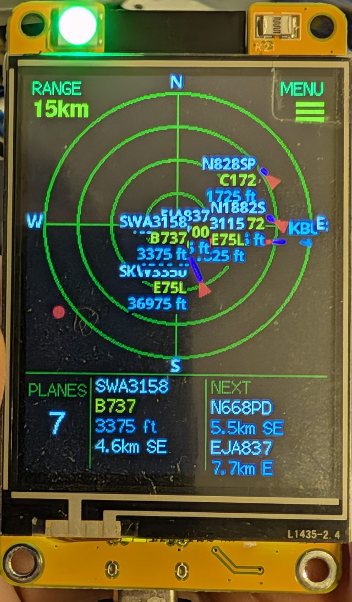
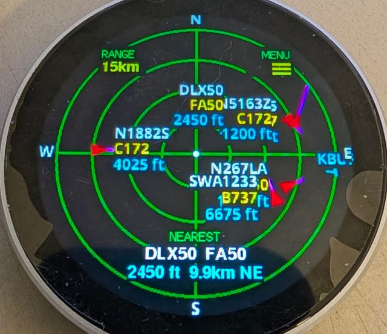
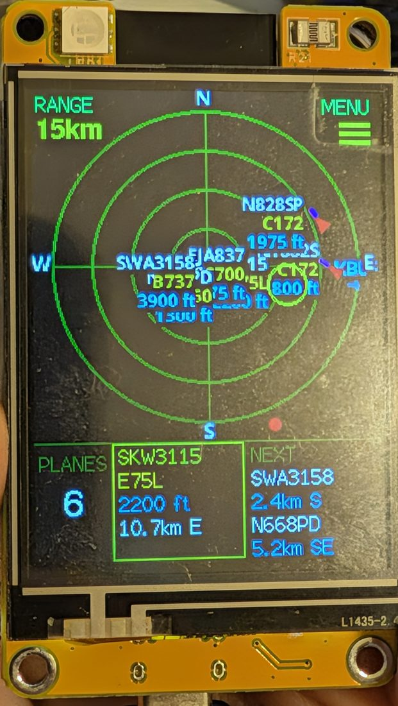
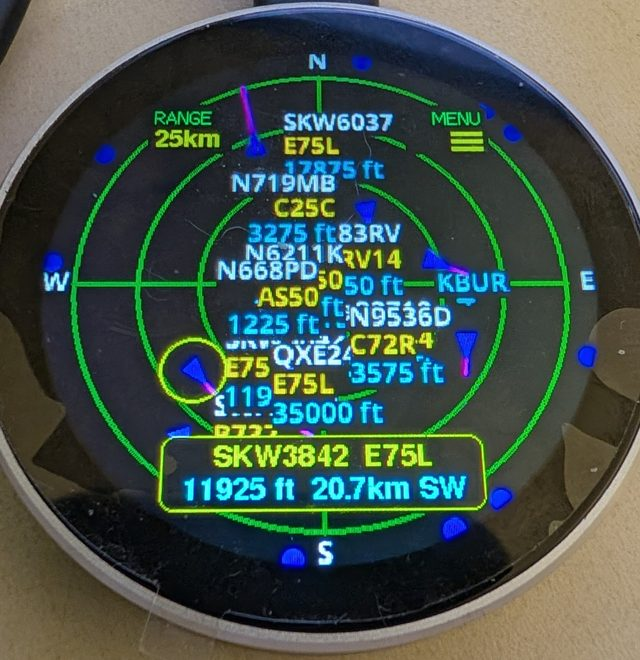
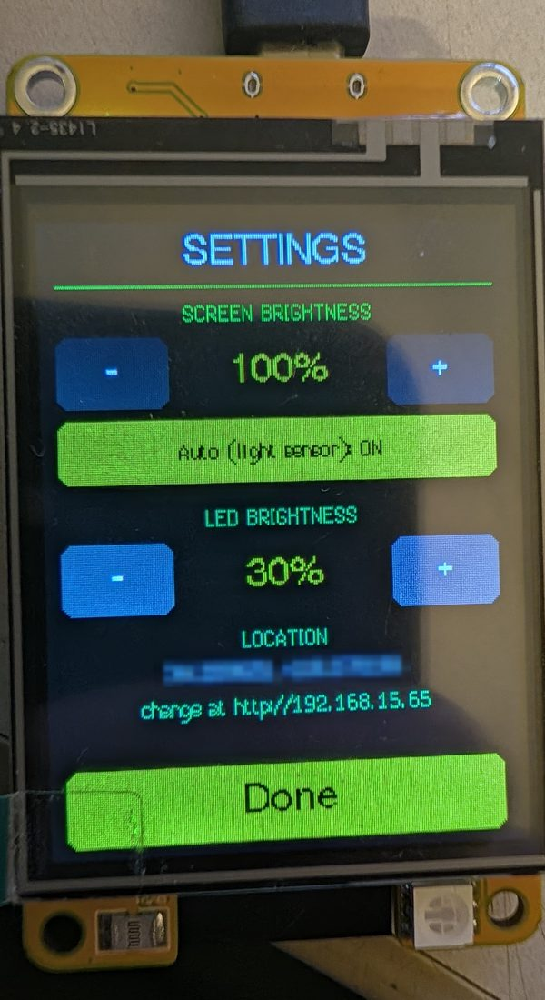
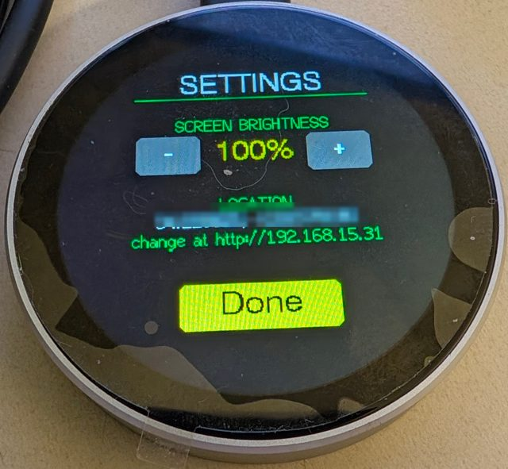
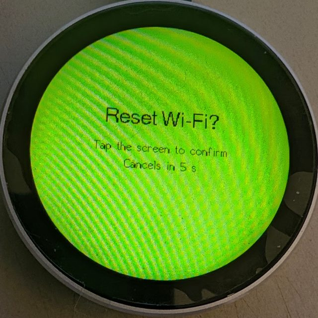
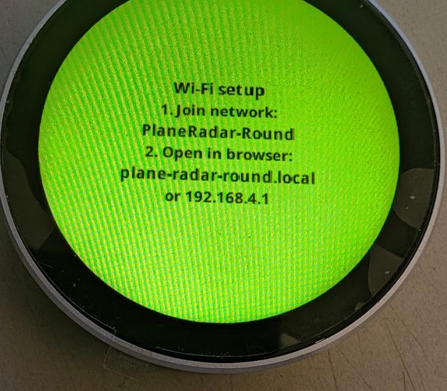

# Plane Radar: CYD and round-display fork

This fork adds two more boards to [MatixYo's Plane Radar](https://github.com/MatixYo/ESP32-Plane-Radar), with touch, an info display and a settings menu. Same code base, one PlatformIO environment per board. The original 1.28" C3 Super Mini build (`env:supermini`) is unchanged and documented further down.

**Install from your browser, no tools needed: [tlaren.github.io/ESP32-Plane-Radar](https://tlaren.github.io/ESP32-Plane-Radar/)** (Chrome or Edge on a computer; it detects the board and installs the right firmware).

| CYD 2.4" (`env:cyd24`) | Round 1.85" (`env:jc3636`) |
| --- | --- |
|  |  |
|  |  |
|  |  |

| Reset Wi-Fi asks to confirm | Setup screen after a reset |
| --- | --- |
|  |  |

## Boards

| | CYD | Round |
| --- | --- | --- |
| Board | ESP32-2432S024R "Cheap Yellow Display" | Guition JC3636W518C (ESP32-S3, 16 MB flash, 8 MB PSRAM) |
| Screen | 2.4" 240x320 ST7789 (sold as ILI9341), resistive touch | 1.85" round 360x360 ST77916 (QSPI), CST816 capacitive touch |
| Radar | 240 px on top, 80 px info strip below | 360 px, fills the circle (all sizes 1.5x) |
| Extras | RGB LED, light sensor | none |
| Setup Wi-Fi / address | `PlaneRadar-CYD` / `plane-radar-cyd.local` | `PlaneRadar-Round` / `plane-radar-round.local` |

## Features added in this fork

- **Info display.** CYD: a strip with the plane count, the nearest airborne plane (callsign, type, altitude, distance, direction) and the next two. Round: the nearest plane above the S label. Planes on the ground are counted but never shown as "nearest".
- **Touch.** Tap **RANGE** to cycle 5 / 10 / 15 / 25 km. Tap a plane to select it: it gets a yellow ring and its details show in a yellow box for 30 s. Tap empty radar to clear it.
- **Settings menu** (tap **MENU**): screen brightness, the saved location, and **Reset Wi-Fi** (asks for a second tap to confirm). The CYD's menu also has LED brightness and auto-brightness.
- **RGB LED** (CYD): solid red when a plane is within 2 mi and below 3000 ft; green blink on each data update; blue blink when Wi-Fi or data is down.
- **Light sensor** (CYD): optional auto-dimming of the screen and LED.
- **Range readout** moved off the rings to a readable corner label.
- **BOOT long-press Wi-Fi reset** now needs an on-screen tap to confirm, so holding BOOT during an upload no longer wipes your settings.
- Fix: Wi-Fi entered right after a reset is now saved (it was lost on the next boot).

## Build and flash

The easy way is the [browser flasher](https://tlaren.github.io/ESP32-Plane-Radar/): plug the board in, click Install, pick its port. On the CYD, hold **BOOT** for the whole install, then press RST. It's rebuilt automatically from this branch on every push. To build it yourself instead:

1. Install VS Code and the PlatformIO extension, then open this folder.
2. Pick the environment for your board: `env:cyd24` or `env:jc3636`.
3. Build and upload.
   - **CYD:** auto-reset into the bootloader doesn't work on these boards. Hold **BOOT** for the whole upload. Set `upload_port` in `platformio.ini` if PlatformIO picks the wrong COM port.
   - **Round:** uploads over USB-C with no buttons. The board has no reset button: unplug it to reset.
4. First boot:
   - **CYD only:** calibrate the touch screen. Drag from each corner arrow toward the centre rather than tapping the tip, because the very edge of the panel doesn't register.
   - **Both:** join the setup Wi-Fi from a phone, open `192.168.4.1`, and enter your Wi-Fi, latitude and longitude. Use 6 decimals at most: the page accepts more but keeps the old value.

## Travelling: follow a phone's position

Take the radar in a car and it can centre itself on where you are, with no typing. It uses your phone's hotspot for internet, and the phone supplies the position.

**One-time setup** (on the radar's setup page, `192.168.4.1` or its LAN address):

1. Under **Phone hotspot name** and **password**, enter your phone's hotspot. Your home Wi-Fi stays as the first network.
2. On an Android phone, install a GPS-sharing app that serves **NMEA over TCP** (for example Share GPS), start its TCP server and note the port. Enter that port under **Phone GPS app port** (default 10110).

**How it behaves**

- At home the radar joins your home Wi-Fi and uses the saved location. Away from home it joins the phone's hotspot instead (it scans and picks whichever of the two is in range).
- On the hotspot it reads GPS from the app on the phone (the hotspot gateway is the phone, so no IP to enter). The first fix is used at once. After that the radar re-centres at most once a minute, and only after you have moved more than 1 km, so it does not churn while you drive.
- **No phone GPS?** After about 20 s it falls back to an approximate position from the Wi-Fi networks in range, looked up through [beaconDB](https://beacondb.net) (only BSSIDs and signal strengths are sent; phone hotspots and networks named `*_nomap` are left out). This is usually good to tens of metres in towns and poor in rural areas; answers worse than 3 km are ignored.
- The menu shows where the position comes from: *saved*, *phone GPS* or *Wi-Fi lookup*. Back on the home Wi-Fi the saved location returns. The travel position is never saved over your home position.
- Keep the GPS app running in the background and its battery optimisation off.

## Board notes

- **CYD panel:** this 2.4" board's screen is an **ST7789**, built with `-DCYD_PANEL_ST7789`. With the ILI9341 driver the picture is mirrored, the colours are wrong and the bottom 80 rows stay noise.
- **CYD LED pins:** on the test board green and blue were swapped from the usual CYD pinout (R4, G17, B16). The LED flashes red, green, blue at boot; if yours shows a different order, swap the pins in `config.h`.
- **CYD light sensor:** retune it for your case with `kLdrDarkRaw` / `kLdrBrightRaw` in `config.h`. The serial log prints `ldr: raw N` every 10 s.
- **Round screen:** needs LovyanGFX 1.2.26 or newer (`Panel_ST77916`). That driver restarts its write position on every 32k-pixel chunk, so this fork pushes the radar in bands on the round board.

---

*The original project README follows.*

# Plane Radar


**3D printed case (STL + assembly):** [MakerWorld](https://makerworld.com/en/models/2872376-esp32-plane-radar-live-ads-b-on-a-round-display#profileId-3207083) · **Firmware:** [Releases](https://github.com/MatixYo/ESP32-Plane-Radar/releases)

Firmware for an **ESP32-C3 Super Mini** and a **1.28″ round GC9A01** display (240×240). Shows a circular **ADS-B radar** around your configured location, with **WiFiManager** for first-time setup.

## What it does

1. **Wi‑Fi setup** (if needed) — captive portal on AP **`PlaneRadar-Setup`**
2. **Radar** — live aircraft from [adsb.fi](https://opendata.adsb.fi/) on a sonar-style grid

After Wi‑Fi is saved, the device reconnects automatically; the radar runs in the main loop with periodic ADS-B updates (~5 s).

## Controls (BOOT, GPIO 9, active LOW)

| Action | Effect |
|--------|--------|
| **Short tap** | Cycle range preset (5 → 10 → 15 → 25 km); saved to flash |
| **Hold 3 s** | Clear Wi‑Fi, location, and units; reboot into setup portal |

During setup you can also hold BOOT at power-on to force a credential reset (same as the long press).

## Wi‑Fi setup portal

**First-time setup** (no saved Wi‑Fi):

1. Connect to **`PlaneRadar-Setup`**
2. Open **`http://plane-radar.local`** (preferred) or **`http://192.168.4.1`** — both are shown on the yellow setup screen; captive portal may open automatically
3. Set home Wi‑Fi, then save

**Reconfigure anytime** (after the device is on your network):

1. Open **`http://plane-radar.local`** or **`http://<device-ip>`** (e.g. from your router or serial log at boot)
2. Change Wi‑Fi, location, units, or runway overlay; save

The same portal runs on the setup AP and on the device’s LAN IP while connected to Wi‑Fi. mDNS hostname is `plane-radar` → **plane-radar.local** (`kPortalHostname` in `config.h`). Some clients resolve `.local` slowly; use the IP if needed.

**Custom fields** (stored in NVS):

| Field | Purpose |
|-------|---------|
| **Latitude / Longitude** | Radar center and ADS-B query position (defaults in `config.h` until set) |
| **Display distances in miles** | Ring scale label in **mi** instead of **km** (e.g. `6mi` vs `10km`) |
| **Show airport runways** | Major-airport runway overlay on the radar (off to hide) |

After a reset, the device reboots and shows the setup screen immediately (no “Connecting” loop on stale credentials).

## Radar display

### Grid

- Dark blue background, subdued green rings and crosshairs
- White **N / S / E / W** at the bezel; range label on the **east** spoke (ring 3 = ¾ of outer radius)
- White center dot

Layout and colors: `include/ui/radar_theme.h`.

### Range presets

| Ring 3 label | Outer radius (aircraft scale) |
|------------|-------------------------------|
| 5 km / 3 mi | ~6.7 km |
| 10 km / 6 mi | ~13.3 km (default) |
| 15 km / 9 mi | ~20 km |
| 25 km / 16 mi | ~33.3 km |

Preset and miles/km choice persist across reboot (`planeradar` NVS namespace).

### Runways

- Major airports from OurAirports (`large_airport`); all open runway strips in range (helipads excluded)
- Teal runway lines with one ICAO label per airport (e.g. `KJFK`); toggle in the Wi‑Fi setup portal
- Update the embedded list: `python3 scripts/build_large_airports.py`

### Aircraft

- **Inside the outer ring** — red heading triangle, magenta speed vector (clipped at the ring), callsign / type / altitude tags
- **Outside the ring** (still within ADS-B fetch) — small **red dot on the screen rim** at the correct bearing (direction cue; not distance-accurate past the ring)
- **Tags** — placed toward the **center**: west (left) → tag on the **right** of the symbol; east (right) → tag on the **left**

As range decreases (or aircraft approach), targets move inward; beyond-ring dots become full symbols when they cross the outer ring.

### ADS-B

- Source: `https://opendata.adsb.fi/api/v3/`
- Fetch radius: `ui::radar::fetchRadiusKm()` — scales with the active preset to roughly the screen edge (so rim dots have data)
- Poll interval: `kAdsbFetchIntervalMs` (5 s) in `config.h`
- Ground aircraft hidden by default (`kAdsbShowGroundAircraft`)

## Configuration

Edit **`include/config.h`** for hardware and behavior:

| Area | Keys / notes |
|------|----------------|
| Portal | `kPortalApName`, `kPortalIp`, `kPortalHostname` / `kPortalHostUrl` (mDNS; needs `-DWM_MDNS` in `platformio.ini`) |
| Wi‑Fi timing | connect attempts, reconnect grace, portal timeout (`0` = no timeout) |
| BOOT | `kBootPin`, `kBootResetHoldMs`, `kBootTapMinMs` |
| Display SPI | pins, `kDisplayInvert`, `kDisplayRgbOrder`, `kDisplaySpiWriteHz` |
| Default location | `kDefaultRadarLat`, `kDefaultRadarLon` (until portal overrides) |
| ADS-B | `kAdsbFetchIntervalMs`, `kAdsbShowGroundAircraft` |

Range presets: `include/ui/radar_range.h` (`kRangePresets`).

## Project layout

```
include/
  config.h
  hardware/
    lgfx_config.hpp
    display.h
    display_font.h
  data/
    large_airports.h
  ui/
    radar_theme.h
    radar_range.h
    radar_display.h
    runway_overlay.h
    status_screens.h
  services/
    wifi_setup.h
    radar_location.h
    adsb_client.h
data/
  ui_font.vlw              — embedded smooth UI font (Noto Sans Bold)
scripts/
  build_large_airports.py
src/
  main.cpp
  data/
    large_airports_data.cpp
  hardware/
  ui/
  services/
```

## Wiring (GC9A01 ↔ ESP32-C3 Super Mini)

| Display | ESP32-C3 |
|---------|----------|
| VCC | 3V3 |
| GND | GND |
| RST | GPIO **0** |
| CS | GPIO **1** |
| DC | GPIO **10** |
| SDA (MOSI) | GPIO **3** |
| SCL (SCLK) | GPIO **4** |
| BOOT (user) | GPIO **9** |

## Build

```bash
pio run -t upload
pio device monitor
```

- PlatformIO env: **`supermini`**
- Serial: **115200** baud
- USB CDC on boot enabled in `platformio.ini` for the Super Mini

### Web-flashable release image

Single `.bin` for [esptool-js](https://espressif.github.io/esptool-js/) and similar tools (ESP32-C3, 4 MB, flash at **0x0**):

```bash
chmod +x scripts/merge-firmware.sh   # once
./scripts/merge-firmware.sh
```

Writes `release/plane-radar-merged.bin`. Skip rebuild if firmware is already built:

```bash
./scripts/merge-firmware.sh --no-build
```

Or via PlatformIO only (output: `.pio/build/supermini/firmware-merged.bin`):

```bash
pio run -e supermini
pio run -t merge -e supermini
```

Put the board in download mode (hold **BOOT**, tap **RESET**), then flash with Chrome/Edge over USB.

### CI and releases (GitHub Actions)

| Workflow | When | Output |
|----------|------|--------|
| [Build](.github/workflows/build.yml) | Push / PR to `main` | Artifact `plane-radar-supermini` (merged + split `.bin` files, ~90 days) |
| [Release](.github/workflows/release.yml) | Git tag `v*` (e.g. `v1.0.0`) | GitHub Release asset `plane-radar-v1.0.0.bin` + `.sha256` |

To ship a version users can download:

```bash
git tag v1.0.0
git push origin v1.0.0
```

The release workflow builds firmware in CI and attaches the merged image to the release. Download from **Releases** on GitHub, then flash at **0x0** (ESP32-C3, 4 MB).

## Dependencies

- [LovyanGFX](https://github.com/lovyan03/LovyanGFX)
- [WiFiManager](https://github.com/tzapu/WiFiManager)
- [ArduinoJson](https://github.com/bblanchon/ArduinoJson)
